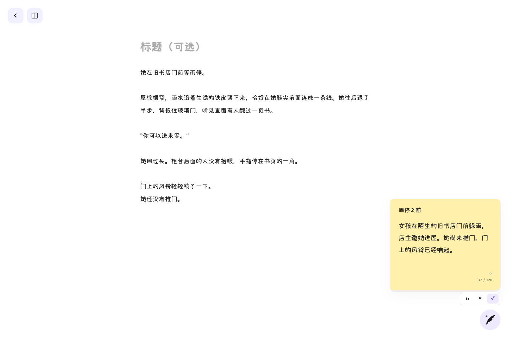
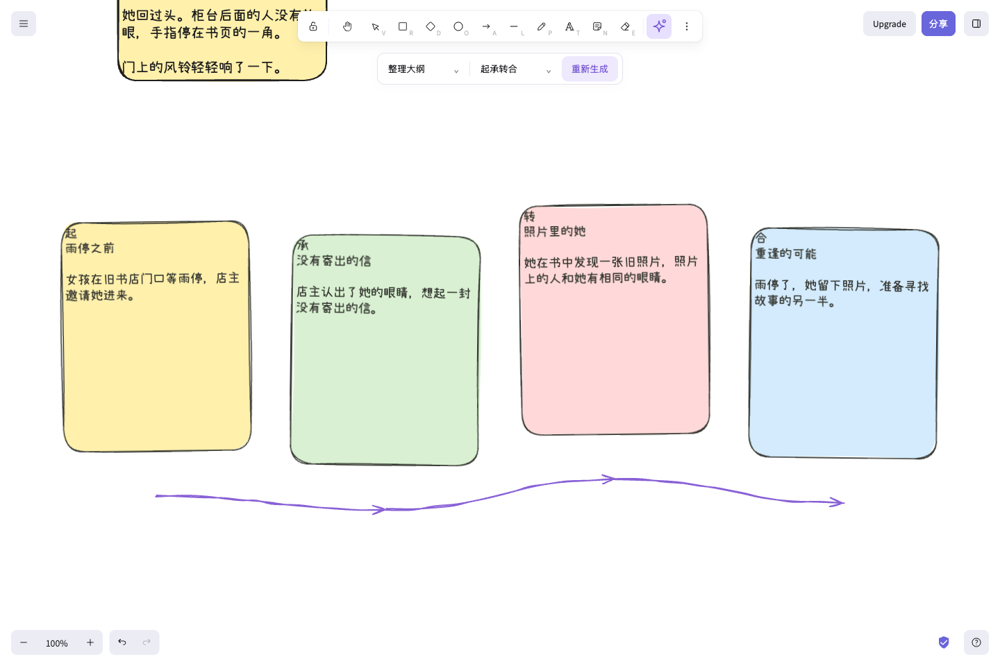

<div align="center">

# Storyknows

**先写喜欢的片段，再让故事连起来。**

给非线性写作者的手绘白板：随手记录、展开写作，让 AI 帮你提炼和组织已有内容。

[功能](#现在可以做什么) · [本地运行](#本地运行) · [AI 配置](#开启-ai可选) · [部署说明](#部署与数据) · [MIT 许可证](LICENSE)


</div>

> 当前为开发中的网页应用，基于 [Excalidraw](https://github.com/excalidraw/excalidraw) 二次开发。上图为依据当前界面制作的宣传插画；下方提供实际页面截图，使用虚构示例内容和模拟 AI 响应展示交互。

## 现在可以做什么

### 先把脑海中的那一幕写下来

在自由白板上记录片段、拖动便签、画关系线。支持独立文字和有绑定文字的图形；图形内的长文可上下滚动。你可以从任何一场戏开始，不需要先完成整份大纲。

### 展开便签，进入沉浸写作

选中文字或有文字的便签，点击右上角外侧的紫色展开图标，进入沉浸写作页。

- 继承片段的字体和文字颜色，标题可选。
- 左侧目录按需展开，不挤压正文。
- 返回白板后继续组织片段。

### 把正文概括成故事卡

点击沉浸页右下角羽毛，为当前片段生成 **120 字以内**的梗概。

先预览，可以手动修改、重新生成或取消；采用后同一张卡片显示梗概，原文仍保留，支持切换查看。AI 不会直接覆盖你的正文。



### 让已有片段连成大纲

白板顶部星光按钮提供两种操作：

| 操作     | 用途                                                 |
| -------- | ---------------------------------------------------- |
| 整理大纲 | 提炼、拆分、合并和组织已经写下的情节，不补写新事件   |
| 生成大纲 | 基于已有内容提出一种发展方向，新增情节标记为 AI 建议 |

- 选择 **起承转合** 或 **三幕式**，无需先逐个生成梗概。
- 有选择时读取选中的片段；没有选择时读取当前白板的可写片段。
- 人物、设定单独放置，归属不明确的内容保留在“暂未归位”，空阶段弱化显示。
- 预览可编辑和拖动，生成后仍可重新生成，点击空白不会清掉结果。
- 采用后成为可编辑的原生画布卡片与阅读顺序箭头，支持原有撤销、重做。
- 节点保留原文来源，支持一对多、多对多；来源删除后保留大纲节点并在来源入口提示。



## 本地运行

需要 Node.js 18+ 与 Yarn 1.x（可通过 npx 调用）。

```bash
git clone https://github.com/lemonbombfall/storyknows.git
cd storyknows
npx --yes yarn@1.22.22 install
npx --yes yarn@1.22.22 start
```

默认打开 `http://localhost:3001`，以终端实际输出为准。

基础白板和写作不需要配置 AI 密钥。当前没有独立桌面安装包或 SQLite 本地后端。

## 开启 AI（可选）

在**仓库根目录**新建 `.env.local`，填写：

```dotenv
DEEPSEEK_API_KEY=填写你自己的密钥
DEEPSEEK_BASE_URL=https://api.deepseek.com
DEEPSEEK_MODEL=deepseek-chat
```

完整示例见 [.env.story-ai.example](.env.story-ai.example)。已有 `.env.local` 时保留其他配置；保存后重启开发服务。URL 不需要附加 `/chat/completions`。

密钥由服务端读取，**不要使用 `VITE_` 前缀、不要写入前端代码、不要提交 `.env.local`**。请求 AI 时，所选正文会发送给配置的模型服务；普通白板操作不需要调用模型。

## 部署与数据

- 画布通过原有浏览器本地存储保存。请定期导出 `.excalidraw` 文件备份；清除浏览器数据可能导致内容丢失。
- 已采用的梗概、原文及来源信息随场景保存；未采用的预览在刷新后丢弃。
- 静态页面可运行基础白板与写作；AI 还需要部署同源 `/api/story-ai` 服务。**只上传静态 build 目录不能启用 AI。**
- 开发时 Vite 已挂载该接口；部署时可将 [api/story-ai.ts](api/story-ai.ts) 接入支持 Node 请求处理器的函数平台或 Node 服务。
- 公开体验版应在服务端配置密钥，并设置共享限流和模型额度。当前进程内基础限流不等于跨实例的全局费用上限。
- 上游协作、云端分享等能力有独立服务依赖，不代表本仓库开箱即用。

详细接口、限制和部署说明见 [AI 写作说明](docs/story-ai.md)。

## 开发与验证

React + TypeScript + Vite；画布、元素与编辑交互沿用 Excalidraw 工程。AI 返回结构化数据，由前端创建画布元素，不通过模型直接操作画布。

```bash
# 类型检查
npx --yes yarn@1.22.22 test:typecheck

# 写作与 AI 模拟测试，不需要密钥
npx --yes yarn@1.22.22 vitest run \
  packages/excalidraw/tests/storyWriting.test.tsx \
  packages/excalidraw/tests/storyAI.test.tsx \
  packages/excalidraw/tests/storyAIEndpoint.test.ts --maxWorkers=1 --minWorkers=1

# 构建网页
npx --yes yarn@1.22.22 build:app
```

| 目录 | 内容 |
| --- | --- |
| `packages/excalidraw/components/StoryWriting.tsx` | 沉浸写作入口与正文编辑 |
| `packages/excalidraw/components/StorySummary.tsx` | 梗概预览、采用与视图切换 |
| `packages/excalidraw/components/StoryAI.tsx` | 大纲工具栏、预览与采用 |
| `packages/excalidraw/story/` | 文档数据、AI 协议与画布布局 |
| `api/story-ai.ts` | 服务端模型调用 |
| `docs/` | 说明与产品图片 |

## 致谢与许可证

Storyknows 基于 [Excalidraw](https://github.com/excalidraw/excalidraw)，保留其手绘画布与编辑能力。感谢上游项目及所有贡献者。

本项目遵循 [MIT License](LICENSE)，保留 Excalidraw 的版权声明。
